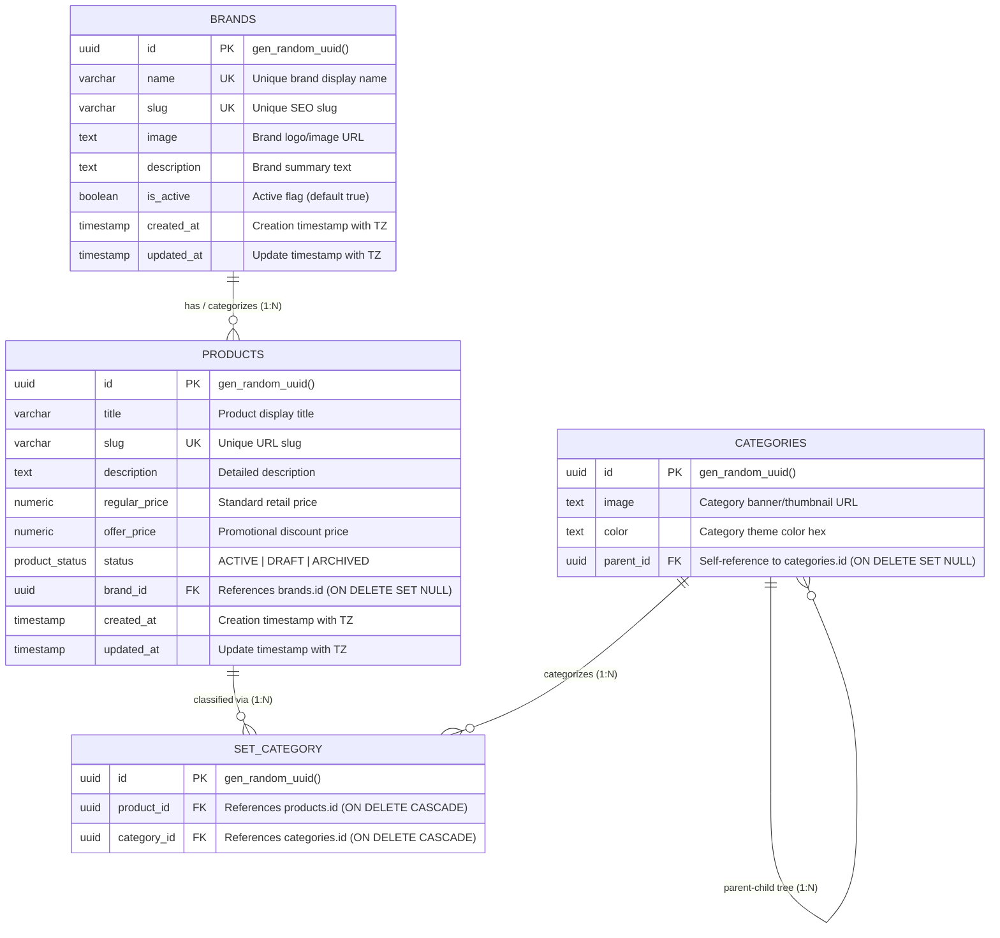
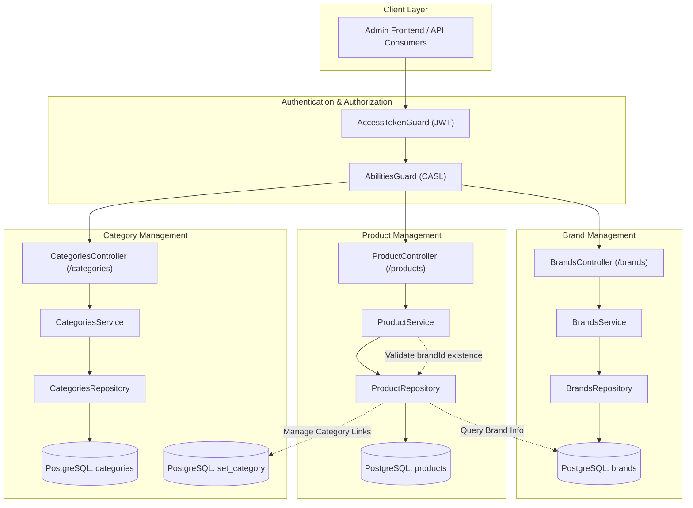
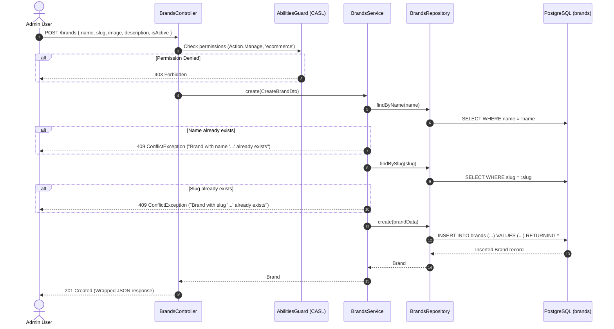
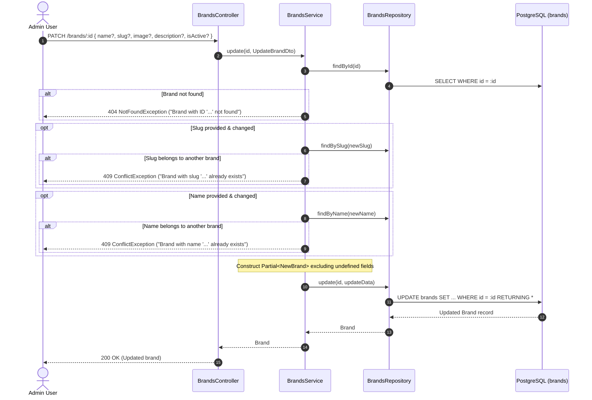
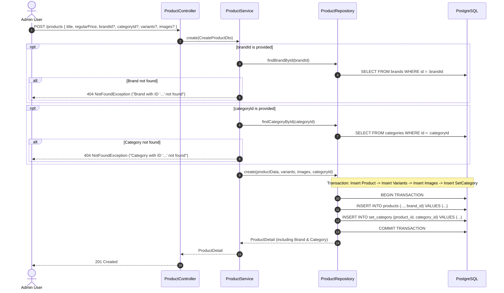
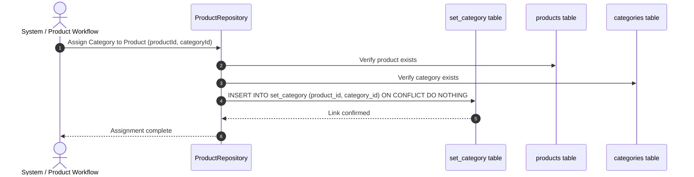

# Category, Brand, and Product Management System Documentation

## 1. Database Entity Relationship Diagram (ERD)

The ecommerce data model organizes catalog items through **Brands**, **Products**, and a self-referential hierarchical **Category** tree joined via the **SetCategory** junction table.



---

## 2. System Architecture



---

## 3. Brand Create Workflow (`POST /brands`)



---

## 4. Brand Update Workflow (`PATCH /brands/:id`)



---

## 5. Product Creation with Brand Selection & Category Assignment



---

## 6. Product-Category Assignment Workflow



---

## 7. Brand Module API Reference

### 7.1. Create Brand

- **Method**: `POST`
- **Path**: `/brands` (also `/api/brands`)
- **Access**: Bearer Token required (`manage:ecommerce` ability)
- **Request Body**:
```json
{
  "name": "Apple",
  "slug": "apple",
  "image": "https://example.com/apple-logo.png",
  "description": "Apple consumer electronics brand",
  "isActive": true
}
```
- **Responses**:
  - `201 Created`: Returns created brand object.
  - `400 Bad Request`: Validation failure (e.g. missing name or slug).
  - `401 Unauthorized`: Missing or invalid JWT.
  - `403 Forbidden`: Insufficient role/permissions.
  - `409 Conflict`: Duplicate brand name or slug.

### 7.2. Update Brand

- **Method**: `PATCH`
- **Path**: `/brands/:id` (also `/api/brands/:id`)
- **Access**: Bearer Token required (`manage:ecommerce` ability)
- **Request Body** (all fields optional):
```json
{
  "name": "Apple Inc.",
  "slug": "apple-inc",
  "image": "https://example.com/apple-logo.png",
  "description": "Updated brand description",
  "isActive": true
}
```
- **Responses**:
  - `200 OK`: Returns updated brand object.
  - `400 Bad Request`: Invalid UUID format or invalid field values.
  - `404 Not Found`: Brand with specified UUID not found.
  - `409 Conflict`: New slug or name already in use by another brand.

### 7.3. List Brands

- **Method**: `GET`
- **Path**: `/brands` (also `/api/brands`)
- **Access**: Public
- **Query Parameters**:
  - `search` (optional string): case-insensitive search in name and description
  - `isActive` (optional boolean): `true` or `false`
  - `page` (optional integer, default 1)
  - `limit` (optional integer, default 10, max 100)
- **Response**: `200 OK` with paginated list and metadata.

### 7.4. Get Single Brand

- **Method**: `GET`
- **Path**: `/brands/:id` (also `/api/brands/:id`)
- **Access**: Public
- **Param**: UUID or unique slug
- **Response**: `200 OK` with brand object, or `404 Not Found`.
